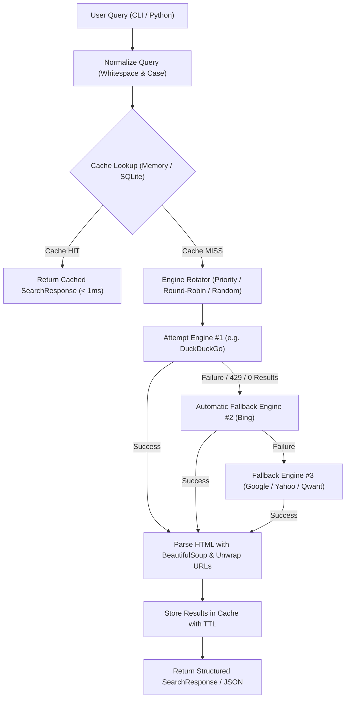

<div align="center">


# ⚡ websearch-py

**Resilient multi-engine web search scraper with automatic fallback, engine rotation, smart caching, and standardized JSON output.**

[](https://pypi.org/project/websearch-py/)
[](https://www.python.org/)
[](https://github.com/astral-sh/uv)
[](https://github.com/laurentvv/websearch-py/tree/main/tests)
[](https://github.com/astral-sh/ruff)
[](https://github.com/laurentvv/websearch-py/blob/main/LICENSE)

[Features](#-key-features) • [Installation](#-installation) • [Quickstart](#-quickstart) • [CLI Usage](#-command-line-interface-cli) • [Engine Health](#-engine-health--bot-challenges) • [Architecture](#-architecture--engine-flow) • [Custom Engines](#-custom-search-engines)

</div>

---

## 🌟 Key Features

- 🔄 **Intelligent Fallback & Rotation**:
  - **Priority Fallback (`FALLBACK_PRIORITY`)**: Queries engines sequentially in priority order. If an engine fails (HTTP 429 rate limit, 202 challenge, CAPTCHA, timeout, or 0 results), the next engine seamlessly takes over.
  - **Round-Robin Load Distribution (`ROUND_ROBIN`)**: Circularly shifts the initial search engine for each incoming query to balance traffic across providers.
  - **Random Rotation (`RANDOM`)**: Picks a randomized starting engine with subsequent fallback.
  - **Concurrent Fastest (`FASTEST`)**: Dispatches queries in parallel across worker threads and returns the fastest valid engine response.
- 🩺 **Engine Health Memory**:
  - Bot challenges (captcha, DuckDuckGo HTTP 202 anomaly page, JavaScript walls) are told apart from genuine "no results" answers.
  - A blocked engine rests (5 min, doubling up to 30 min) instead of being asked again on every query; `engine_status()` shows who rests and why.
- ⚡ **Zero-Latency Smart Cache (< 1ms)**:
  - **In-Memory Cache (`InMemoryCache`)**: Thread-safe with configurable TTL (Time-To-Live) and LRU (Least-Recently-Used) eviction.
  - **Persistent SQLite Cache (`SQLiteCache`)**: Disk-backed cache with WAL mode, B-Tree indexes, and automated expired entry purging.
  - **Query Normalization**: Canonical query sanitization (case folding, whitespace collapsing) guarantees instant cache hits for duplicate queries.
- 🌐 **Built-in Search Engine Providers**:
  - **DuckDuckGo** (HTML & Lite endpoints with direct redirect unwrapping)
  - **Bing** (HTML scraper with automatic Base64 redirect decoding `u=a1...`)
  - **Google** (Desktop & Basic HTML layouts with EU consent cookie bypass)
  - **Yahoo Search**
  - **Qwant** (API & Lite scraper)
  - **Brave Search**
  - **Mojeek** (Independent index)
- 📦 **Standardized JSON Output**:
  - Clean standardized output schema: `titre`, `url`, `extrait` (with English aliases `title`, `snippet`).
  - Direct JSON serializer function (`search_json()`) or structured model (`SearchResult`, `SearchResponse`).
- 🛠️ **Developer Ergonomics**:
  - Full **Python 3.14+** support and managed via [**uv**](https://github.com/astral-sh/uv).
  - Modern typing with `py.typed` compliance.
  - Interactive CLI (`websearch` / `websearch-py`).

---

## 📥 Installation

```bash
# Install via uv / pip
uv add websearch-py
# or
pip install websearch-py
```

Or clone the repository from source:

```bash
# Clone repository
git clone https://github.com/laurentvv/websearch-py.git
cd websearch-py

# Sync dependencies and set up virtual environment
uv sync
```

---

## 🚀 Quickstart

### 1. Basic Python Search

```python
from web_search import search

# Perform a web search with automatic fallback and caching enabled
response = search("Python 3.14 new features", max_results=5, language="en")

print(f"Engine Used  : {response.engine_used}")
print(f"From Cache   : {response.cached}")
print(f"Elapsed Time : {response.execution_time_ms:.1f}ms")
print(f"Total Results: {len(response.results)}\n")

for item in response.results:
    print(f"[{item.rank}] {item.titre}")
    print(f"    URL    : {item.url}")
    print(f"    Snippet: {item.extrait}\n")
```

---

### 2. Direct Standard JSON Output

```python
from web_search import search_json

# Export clean JSON array of [{titre, url, extrait}]
json_data = search_json("FastAPI web framework tutorial", max_results=3, indent=2)
print(json_data)
```

**JSON Output:**
```json
[
  {
    "titre": "FastAPI Framework",
    "url": "https://fastapi.tiangolo.com/",
    "extrait": "FastAPI is a modern, fast (high-performance), web framework for building APIs with Python 3.8+ based on standard Python type hints."
  },
  {
    "titre": "FastAPI Tutorial - W3Schools",
    "url": "https://www.w3schools.com/python/python_fastapi.asp",
    "extrait": "Learn how to use FastAPI to build web APIs with Python. Step-by-step tutorial with code examples and interactive exercises."
  }
]
```

To include execution metadata (engine used, cache status, latency, fallback history):
```python
detailed_json = search_json("FastAPI tutorial", detailed=True, indent=2)
print(detailed_json)
```

---

### 3. Advanced Configuration (`WebSearcher`)

```python
from web_search import WebSearcher, RotationStrategy, SQLiteCache

# Configure orchestrator with Round-Robin rotation and persistent SQLite cache
searcher = WebSearcher(
    engines=["duckduckgo", "bing", "yahoo", "google", "qwant"],
    strategy=RotationStrategy.ROUND_ROBIN,
    cache=SQLiteCache(db_path="search_cache.db", default_ttl_seconds=86400),  # 24h TTL
    timeout=10.0,
)

# 1st query: network fetch with engine rotation
r1 = searcher.search("Machine Learning Python")

# 2nd identical query: instant response served from SQLite cache (< 1ms)
r2 = searcher.search("  MACHINE LEARNING Python   ")
assert r2.cached is True
```

---

## 💻 Command Line Interface (CLI)

The library provides the `websearch` executable:

```bash
# Human-readable formatted search
uv run websearch "Python 3.14" -n 5

# Output as clean standard JSON
uv run websearch "tetris html css js" -n 5 --json

# Detailed JSON with metadata (engine used, latency, cache status)
uv run websearch "DuckDB documentation" --detailed

# Save results directly to a JSON file
uv run websearch "FastAPI" --json -o results.json

# Specify search engines and Round-Robin rotation strategy
uv run websearch "Generative AI" -e duckduckgo,bing,yahoo -s round_robin

# Bypass cache for fresh live results
uv run websearch "Breaking tech news" --no-cache

# Purge SQLite cache database
uv run websearch --clear-cache

# List available search engines
uv run websearch --list-engines
```

---

## 🩺 Engine Health & Bot Challenges

Scraped engines regularly answer with a captcha, an HTTP 202 / 403 / 429, or a page without results that is really a
block. The library tells the three situations apart:

| Engine answer | Raised | Engine rests? |
| --- | --- | --- |
| Bot challenge: captcha page, DuckDuckGo anomaly page (HTTP 202), Google "sorry" redirect or JavaScript wall, Qwant captcha answer | `ChallengeError` (a `RateLimitError`) | yes |
| Refusal: HTTP 429, DuckDuckGo HTTP 403, Qwant HTTP 403 or `error_code` 24 | `RateLimitError` | yes |
| Genuine "no results" page, parse failure, timeout, other HTTP errors | `EngineError` | no |

- A challenge is recognised from the **structure** of the page (captcha widgets and scripts, challenge forms, a title
  that is entirely a challenge title, a challenge sentence opening the page). A result or "no results" page that merely
  contains words such as "captcha" or "unusual traffic" (in a snippet, or because they are the query) is not a block.
- An engine that hit a block **rests** for 5 minutes, doubling on each consecutive block up to 30 minutes, and is skipped
  by the next queries: you stop paying a failed request per query and stop hammering a blocked engine. A successful
  search clears the memory of the engine, so its next block starts again from 5 minutes. If every engine is resting they
  are all tried anyway.
- The memory is process-wide by default (`SHARED_HEALTH`), so it also works with the throw-away searchers created by the
  top-level `search()` helper. Pass `WebSearcher(health=EngineHealth(cooldown_s=60, max_cooldown_s=600))` for your own
  policy.

### Inspecting engine health: `engine_status()`

```python
from web_search import WebSearcher

searcher = WebSearcher(engines=["duckduckgo", "bing", "mojeek"], cache=False)
response = searcher.search("python 3.14 release notes")
print(response.engine_used, response.fallback_history)

for name, state in searcher.engine_status().items():
    if state["resting"]:
        print(f"{name}: resting {state['rest_left_s']:.0f}s after {state['consecutive_blocks']} block(s)")
        print(f"    {state['last_error']}")
```

Output when DuckDuckGo answers with its bot challenge and Bing takes over:

```text
bing ['duckduckgo', 'bing']
duckduckgo: resting 300s after 1 block(s)
    [duckduckgo] DuckDuckGo answered with a bot challenge (HTTP 202)
```

`engine_status()` returns one entry per engine that has been asked so far (an engine that was never reached is absent):

```python
{
    "duckduckgo": {
        "resting": True,  # skipped by the next queries
        "rest_left_s": 300.0,  # seconds before it is asked again
        "consecutive_blocks": 1,  # blocks in a row; the rest doubles with each one
        "last_error": "[duckduckgo] DuckDuckGo answered with a bot challenge (HTTP 202)",
    },
    "bing": {"resting": False, "rest_left_s": 0.0, "consecutive_blocks": 0, "last_error": ""},
}
```

With the top-level helpers, read the shared memory directly: `SHARED_HEALTH.status()` returns the same dictionary and
`SHARED_HEALTH.reset()` forgets every block.

---

## 📐 Architecture & Engine Flow



---

## 🔌 Custom Search Engines

Easily create and register custom search providers by inheriting from `BaseSearchEngine`:

```python
from web_search import BaseSearchEngine, EngineRegistry, SearchResult, WebSearcher


class WikipediaSearchEngine(BaseSearchEngine):
    name = "wikipedia"
    display_name = "Wikipedia OpenSearch"

    def search(self, query: str, max_results: int = 10, language: str = "en", region=None) -> list[SearchResult]:
        url = f"https://{language}.wikipedia.org/w/api.php"
        params = {"action": "opensearch", "search": query, "limit": str(max_results), "format": "json"}
        resp = self.session.get(url, params=params, headers=self.get_headers(), timeout=self.timeout)
        data = resp.json()

        titles, snippets, links = data[1], data[2], data[3]
        return [
            SearchResult(
                titre=titles[i],
                url=links[i],
                extrait=snippets[i] if i < len(snippets) else "",
                engine=self.name,
                rank=i + 1,
            )
            for i in range(len(titles))
        ]


# Register engine
EngineRegistry.register("wikipedia", WikipediaSearchEngine)

# Use with automatic fallback to DuckDuckGo
searcher = WebSearcher(engines=["wikipedia", "duckduckgo"])
response = searcher.search("Albert Einstein", max_results=3)
```

---

## 🧪 Testing & Code Quality

The test suite (162 tests) is offline: engine answers are mocked or replayed from the pages in `tests/fixtures/`, and any
socket connection attempted by a test is refused.

```bash
# Quality gate: lint, format check, tests
uv run ruff check . && uv run ruff format --check . && uv run pytest -q

# Run with test coverage report
uv run pytest --cov=websearch_py --cov-report=term-missing

# Opt-in live tests against the real engines (network, may hit rate limits)
WEBSEARCH_LIVE=1 uv run pytest tests/test_live_integration.py -v
```

---

## 📄 License

This project is licensed under the [MIT License](LICENSE).
